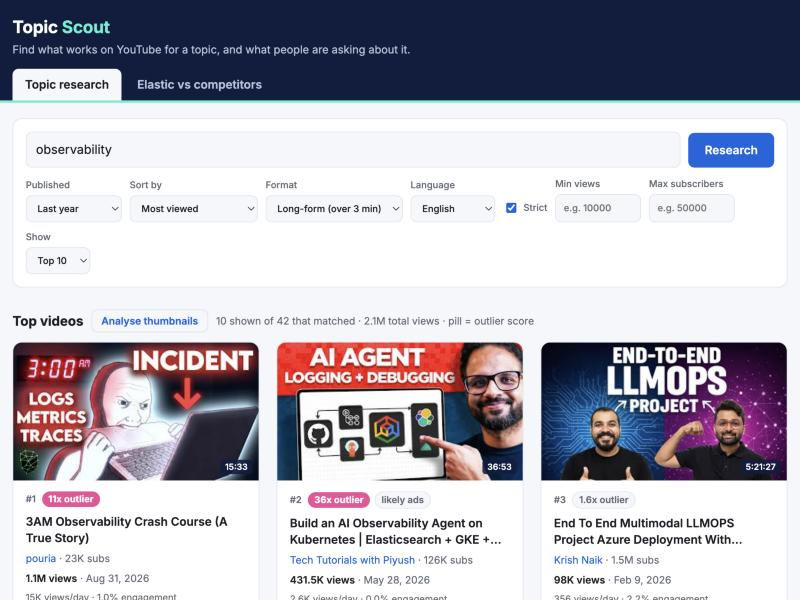

# YouTube Research - Topic Scout

A small local web app to research a topic before you make a video about it. It is a free, open alternative to paid tools like vidIQ and TubeBuddy.

I make developer videos at Elastic and built this to solve my own problem: YouTube search no longer lets me ask simple things like "the most viewed observability videos of the last year". I hope it is useful to you too.



## What it does

Type a topic and it shows:

- **Top videos**, with filters YouTube does not give you: date range, Shorts or long-form, language, minimum views, maximum channel size.
- **Outlier score**: a video's views compared with what that channel normally gets. A high score means the topic worked, not just the channel's size.
- **Why did it perform?** A plain breakdown of each video's numbers, title and top comments.
- **Questions from the comments**, plus Elastic forum topics and Google search suggestions on the same topic.
- **Thumbnail analysis** (optional): Claude compares the thumbnails on screen.

It's made to help me with my day job at Elastic, so a second tab compares Elastic's channels with competitors (Datadog, Grafana, OpenSearch and others). To change the list, edit `CHANNELS` in `index.html`.

## Get started

You need [Node.js](https://nodejs.org/) 18 or newer and a free YouTube API key.

**1. Get the code**

```bash
git clone https://github.com/suyashcjoshi/youtube-research.git
cd youtube-research
```

**2. Create a YouTube API key** (free, no credit card)

1. Open the [Google Cloud Console](https://console.cloud.google.com/) and create a project.
2. Open the [YouTube Data API v3 page](https://console.cloud.google.com/apis/library/youtube.googleapis.com) and click **Enable**.
3. Go to [Credentials](https://console.cloud.google.com/apis/credentials), click **Create credentials**, then **API key**, and copy it.

**3. Add the key**

```bash
cp .env.example .env
```

Open `.env` and paste the key after `YOUTUBE_API_KEY=`.

**4. Run and open**

```bash
node server.js
```

Open http://localhost:3456, type a topic and click **Research**. Press `Ctrl + C` in the terminal to stop.

### Optional: thumbnail analysis with your own Anthropic key

This is the only paid part: each click costs a few cents on your Anthropic account.

1. Create an API key in the [Claude Console](https://console.anthropic.com/) and paste it into `.env` after `ANTHROPIC_API_KEY=`.
2. Run `npm install`, then start the app again.
3. Click **Analyse thumbnails** above any video grid.

## Limits

The app only sees what YouTube's public API gives out:

- **Quota**: about 75 new searches a day per key. Repeating a search within an hour is free.
- **No transcripts, retention or click-through rate.** The app reads public numbers and comments; it does not watch videos.
- **Shorts are a guess**: any video of 60 seconds or less.
- **Search is not complete**: YouTube returns its own pick of 50 matching videos.

Your keys stay on your machine. `.env` is ignored by git.

## What's next

See [TODO.md](TODO.md) for ideas, including hook analysis, search inside videos, and storing everything in Elasticsearch.

## License

MIT. See [LICENSE](LICENSE).
